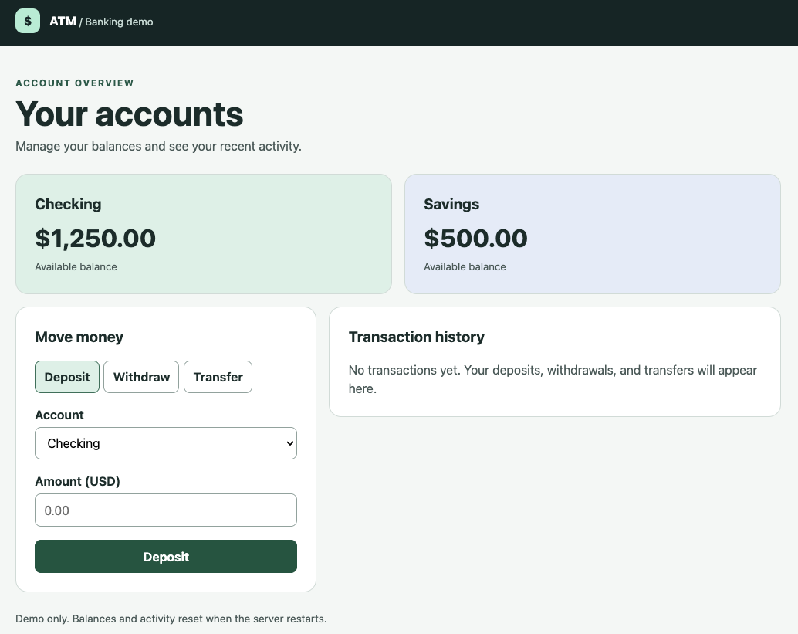
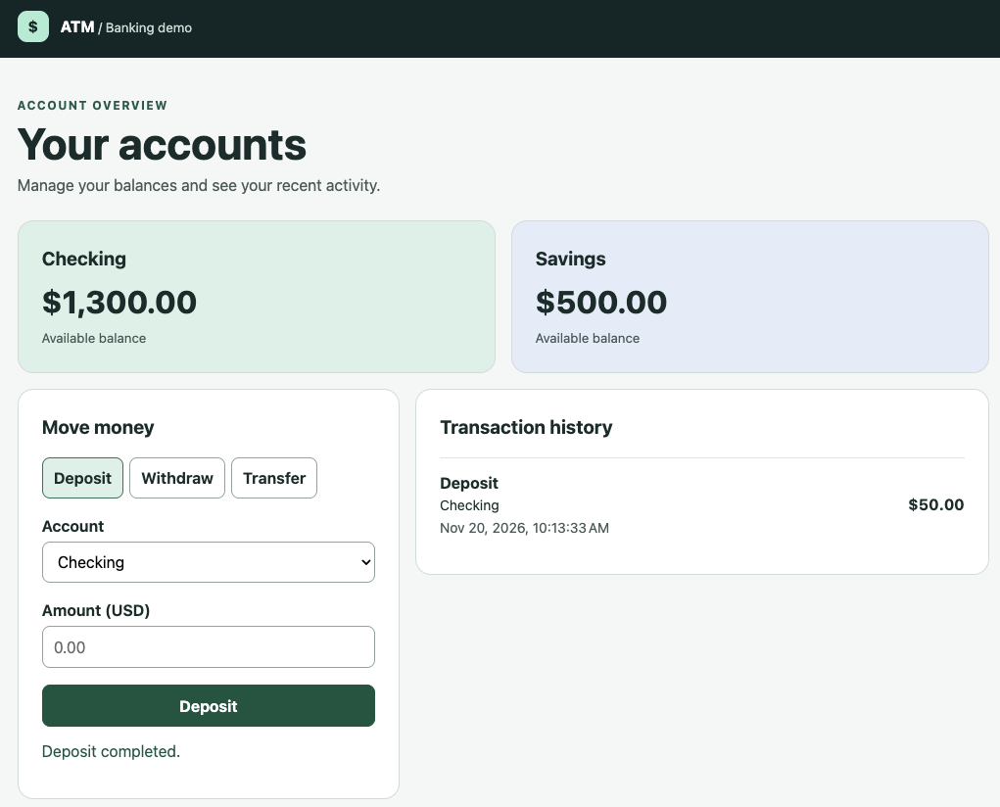
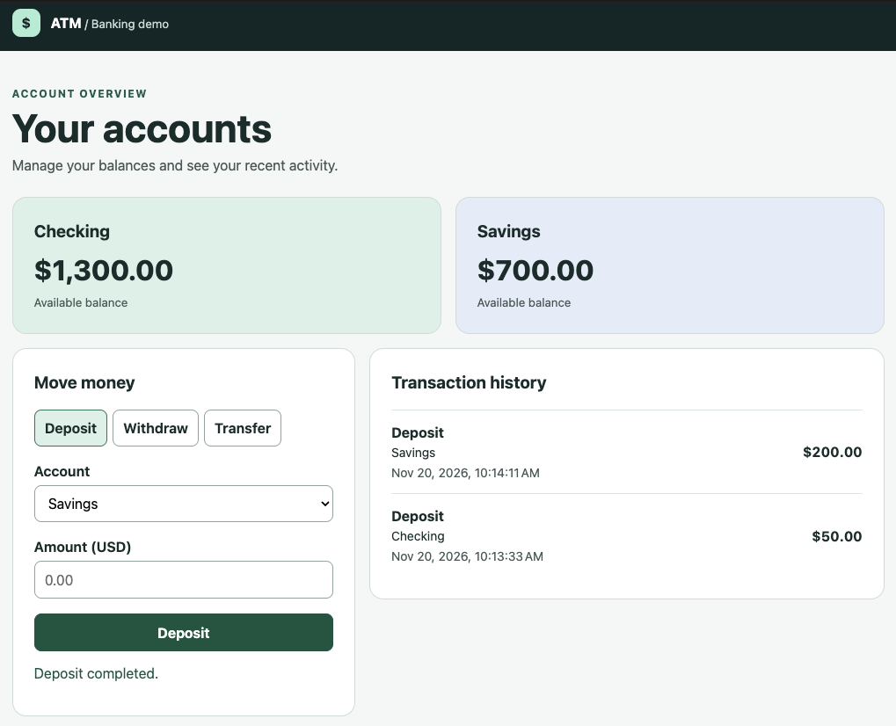
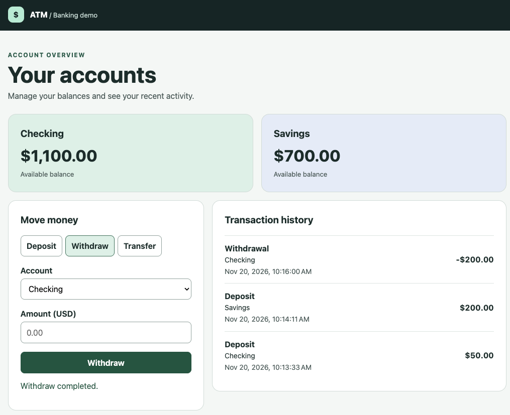
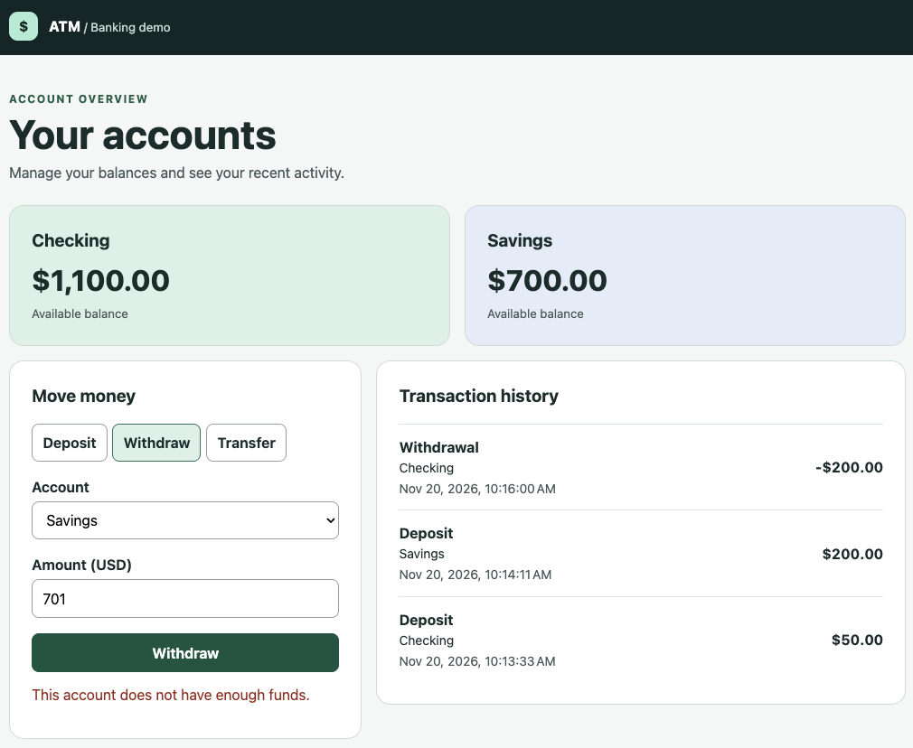
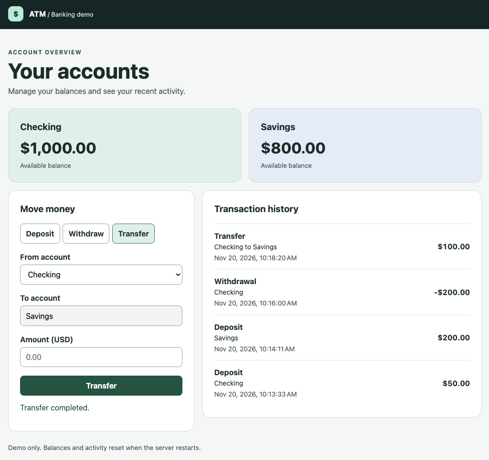

# ATM coding exercise

A single-user Angular ATM for depositing, withdrawing, and transferring USD between `Checking` and Savings`. The dashboard shows available balances and newest-first transaction history. No sign-in or database setup is required.

## Run locally

Install the .NET 10 SDK and Node.js 24 LTS (with npm).

From the repository root, start the API:

```sh
dotnet run --project ATM.Api --launch-profile http
```

In another terminal, start Angular:

```sh
cd atm-web
npm ci
npm start
```

Open [http://localhost:4200](http://localhost:4200). Angular proxies `/api` requests to the API on port `5111`. Each API restart restores the starting balances ($1,250 in Checking and $500 in Savings) and clears the history.

## Architecture

| Project | Responsibility |
|---|---|
| [ATM.Domain](./ATM.Domain) | Account and transaction entities; rules for positive, cent-precision amounts, sufficient funds, and transfers between different accounts. |
| [ATM.Application](./ATM.Application) | Separate command and query handlers, plus the repository interface. |
| [ATM.Contracts](./ATM.Contracts) | Request and response DTOs. |
| [ATM.Infrastructure](./ATM.Infrastructure) | EF Core InMemory context, account seeding, and repository implementation. |
| [ATM.Api](./ATM.Api) | ASP.NET Core endpoints, dependency wiring, and HTTP error mapping. |

Commands update tracked accounts and append a single history entry in one EF Core save. A process-local gate serializes reads and writes so concurrent requests cannot spend the same balance or read a mismatched dashboard. The gate is scoped to this single-process exercise; the app is not a production banking system.

## API

| Method and path | Request body |
|---|---|
| `GET /api/atm/dashboard` | None; returns both accounts and transaction history. |
| `POST /api/atm/deposits` | `{"accountId":"checking","amount":25.50}` |
| `POST /api/atm/withdrawals` | `{"accountId":"checking","amount":10.00}` |
| `POST /api/atm/transfers` | `{"fromAccountId":"checking","toAccountId":"savings","amount":20.00}` |

Successful commands return `204 No Content`. Rejected commands return Problem Details with a machine-readable `code`: `400` for invalid input, `404` for an unknown account, or `409` if the account balance cannot support the operation.

## Verify

```sh
dotnet build ATM.slnx
npm --prefix atm-web run build
node scripts/smoke-test.mjs
```

Run the smoke test against a freshly started API. It performs transactions and checks balances, history, rejected operations, and concurrent withdrawals. To run it again, restart the API first. The script accepts an optional base URL, such as `http://localhost:4200`, to test through Angular's proxy.

# AI Disclaimer
I used AI for the coding of most of the Front End of the application, and for some of the coding of the API, however, all the decisions of technical and design decisions are my own.

# Decisions I took
1. To create separate the application on the different layers:
    - .Api: Controller, a minimal API was used in this case.
    - .Infrastructure: Create the concrete instanceces of objects like required repositories.
    - .Contracts: Contracts with the external world, i.e. Requests and Responses for the controller.
    - .Application: Use cases, business logic, and interfaces.
    - .Domain: Most inner layer, define the entities that are going to be used on the application.
1. Use Entity Framework: Since it is the most common ORM used on dotnet, and since it could be integrated with OData protocol in a very easy way.
1. Use Dependency Injection: To avoid the creation of instances all over the code.
1. Use the repository pattern: Even when Entity Framework allready has an abstraction for the context, I prefer to continue using the repository pattern for clearer code and separation of concerns.  It is clearer to call `accountRepository.getAccountById(id)` than `context.Accounts.FirstOrDefault(account => account.id == id)`.

# Extra things I would have done in a more real application
1. Dockerize the application.
1. Not use on memory database, but instead use SQL, or Oracle, or some real database.
1. Take some of the parameteres from appsettings.json, like the initial balance, connection string, etc.

# Demo and screenshots
## Initial State
Initial balance of $1,250.00, no transaction history



## Deposit




## Withdraw



## Transfer
